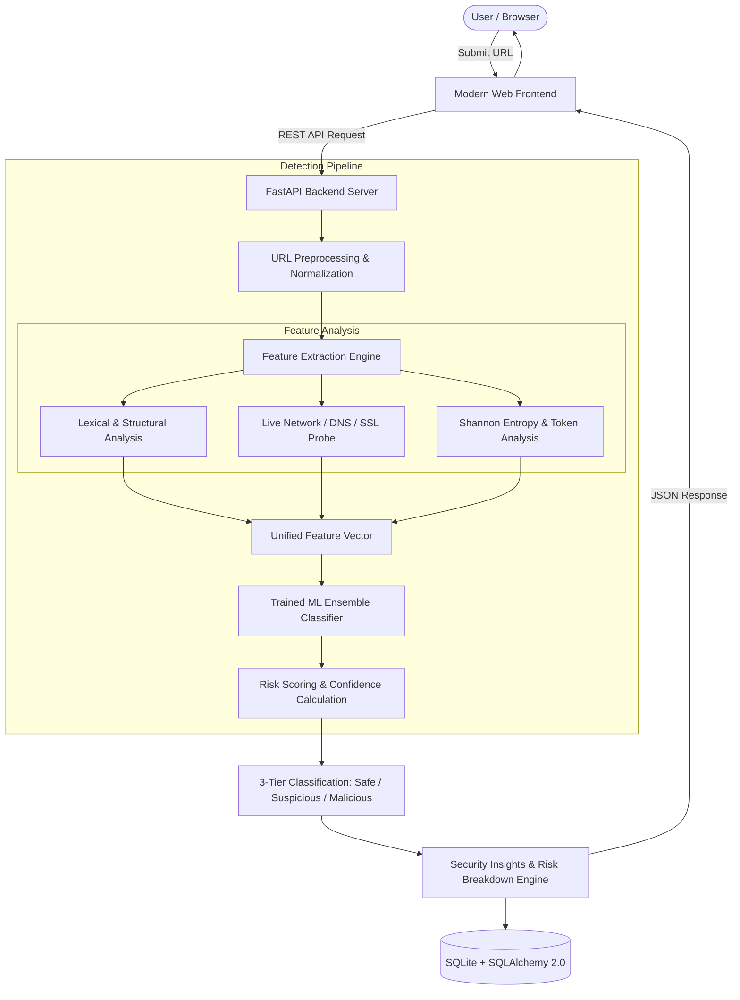

# Implementation Plan: Detecto — AI Malicious URL Detector MVP

Based on the project synopsis (**Detecto**, SCSIT DAVV Indore by Mohammad Umar Ansari & Ankit Singh), this plan outlines the architecture, pipeline, milestones, and testing methodology to build a fully functional, production-ready MVP capable of evaluating **real-world URLs** in real time.

---

## 1. System Architecture Overview

---

## 2. Core Modules & Specifications

### Module 1: Dataset Acquisition & ML Pipeline
* **Data Sources**:
  * Legitimate URLs: Tranco / Majestic top domains + curated benign web samples.
  * Malicious & Phishing URLs: PhishTank active database + URLhaus + Kaggle malicious URL datasets (300k+ samples).
* **Feature Extraction Engine (Real-World Features)**:
  1. **Lexical & Structural**:
     * URL length, domain length, path length, query parameter count.
     * Count of special characters: `.`, `-`, `_`, `/`, `?`, `=`, `&`, `%`, `@`.
     * Presence of IP address as host (IPv4 / IPv6).
     * Number of subdomains (e.g., detecting multi-level subdomains imitating brands).
     * Suspicious keywords frequency (`login`, `signin`, `verify`, `banking`, `secure`, `update`, `paypal`, `wallet`, `admin`).
     * Use of URL shorteners (`bit.ly`, `tinyurl`, `is.gd`, etc.).
  2. **Statistical & Information Theory**:
     * Shannon entropy of the domain name and full path (detects random/algorithmic DGA domains).
     * Vowel-to-consonant ratio and digit-to-letter ratio.
  3. **Live Network Probing**:
     * DNS host resolution check (identifies dead domains or fast-flux domains).
     * HTTPS/TLS certificate verification & protocol scheme.
* **Model Selection & Training**:
  * Evaluation of **Random Forest** vs. **XGBoost** on an 80/20 train/test split.
  * Evaluation metrics: Accuracy, Precision, Recall, F1-Score, and ROC-AUC.
  * Serialization: Export trained model and fitted preprocessor via `joblib`.

### Module 2: Backend Architecture (FastAPI + SQLAlchemy)
* **Framework**: Python FastAPI (asynchronous, high performance, OpenAPI documentation).
* **Database**: SQLite 3 with SQLAlchemy 2.0 ORM:
  * `ScanRecord` model: `id`, `url`, `domain`, `classification` (Safe/Suspicious/Malicious), `risk_score` (0–100%), `confidence`, `features_json`, `network_status`, `scanned_at`.
* **API Endpoints**:
  * `POST /api/scan`: Accepts `{ "url": "..." }`, runs validation, extracts features, performs live network probes, queries the ML model, logs to database, and returns real-time verdict with security rationale.
  * `GET /api/history`: Paginated list of recent URL scans with filters by risk tier.
  * `GET /api/stats`: Aggregated summary (total scans, % safe, % suspicious, % malicious, top flagged TLDs/patterns).
  * `GET /api/health`: System and model status check.

### Module 3: Frontend Dashboard
* **Design & Aesthetics**: Sleek dark/light cyber-defense console aesthetic with glowing status indicators and micro-interactions.
* **Key Components**:
  * **Interactive URL Scanner**: Input bar with protocol normalization and instant validation.
  * **Verdict Card**: Dynamic color-coded classification badge:
    * 🟢 **Safe**: Legitimate domain patterns, valid certificates, benign structure.
    * 🟡 **Suspicious**: Anomalous structure, high entropy, or newly observed patterns requiring caution.
    * 🔴 **Malicious**: High probability of phishing, malware, or brand spoofing.
  * **Risk Confidence Gauge**: Visual percentage meter (0% to 100% threat probability).
  * **Feature Breakdown Panel**: Highlights *why* the URL was flagged (e.g., "Contains 4 subdomains", "IP in URL", "High character entropy: 4.8", "Suspicious token: 'verify'").
  * **Recent Scan Feed & History**: Filterable list of previous scans with quick re-test.

---

## 3. Step-by-Step Implementation Timeline

| Phase | Milestone | Estimated Time | Deliverables |
| :--- | :--- | :--- | :--- |
| **Phase 1** | **Dataset & Model Training** | 2 Hours | Clean dataset, feature extractor script, trained & validated ML model saved as artifact (`model.joblib`). |
| **Phase 2** | **Backend API & Database** | 1.5 Hours | FastAPI app, SQLAlchemy models, live network probe service, `/api/scan` & `/api/history` endpoints. |
| **Phase 3** | **Interactive Frontend UI** | 2 Hours | Responsive cyber-security scanner dashboard with live gauge, feature inspector, and history viewer. |
| **Phase 4** | **Testing & Validation** | 1 Hour | Verification on live real-world domains (Google, GitHub, Wikipedia, Microsoft) and live phishing samples (PhishTank feed). |

---

## 4. Real-World Validation Strategy

To ensure zero dependence on mock URLs:
1. **Benign Baseline Test**: Run 20+ top real-world global domains and multi-path URLs (e.g., `https://aws.amazon.com/console/`, `https://en.wikipedia.org/wiki/Phishing`). Expected result: **Safe** (>95% confidence).
2. **Suspicious Pattern Test**: Test dynamically synthesized high-risk patterns (e.g., `http://192.168.1.1/paypal/login-verification/account-update.php`, URLs with 5 subdomains, dynamic DNS domains). Expected result: **Suspicious / Malicious**.
3. **Live Threat Feed Verification**: Pull current active phishing links from the public PhishTank feed and run them through the detection pipeline to verify real-time zero-day detection.

---

## 5. Decision Points & Options

Before kicking off code implementation, consider the following preferences:
1. **Frontend Preference**: Would you prefer a unified single-repo dashboard (FastAPI serving a modern HTML5/CSS3/Vanilla JS UI) for zero-configuration instant launch, or a separate React/Vite frontend?
2. **Live Network Probing**: Do you want live DNS/SSL socket checks enabled by default (takes ~200-400ms per real URL), with an instant pure-lexical fallback if offline?
